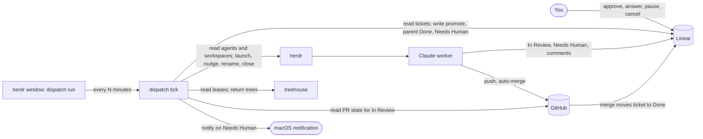

# Autonomous Build (Phase 2)

> This is the Phase 2 design. The dispatcher has since become a reconcile loop that events wake, so the tick, `cache.json`, `--dry-run` and `interval_minutes` described below are gone. `docs/guide.md` describes what runs now.
>
> Parts of this blueprint are superseded. Read "Dispatcher blueprint edits owed" in `decision-log.md` before treating any rule here as current.

## Changes from build (ENG-393)

The reconcile loop shipped in ENG-393 differs from the event-driven blueprint in the places below. They are deliberate. Read them before "fixing" the code back to the blueprint. The event-driven blueprint is a Linear document ("Blueprint: event-driven dispatch") and was not edited, so it still describes the first column.

| The blueprint says | What shipped | Why |
|---|---|---|
| After a Linear write, read the one ticket. | The loop re-runs the three tracked queries, up to 3 calls per write. Before a move or escalation the executor checks status with `LeasedTickets([id])`. | The `linear.Workspace` port has no single-ticket read. A single-ticket query is a follow-up. |
| Cycles are capped at one per second. | A cycle runs once per batch of queued events. | The cap only bounds cost, and a fake clock would have to tick for it. |
| `dispatch tick` is an event. | A tick counts as a resync for retries and clears the nudge overlay. | Tests and users tick to see a failed action retried. |
| History `world` lines hold the world. | They hold changes to dispatch's memory (first-seen times, previous status, blocker waits, pool returns). The header has `why`, `config` and `at` but not `version` or `rulesCommit`. | The memory is what a restart needs. Every fact is re-read at start. |
| `on` rules match events such as `linear.comment.posted`. | Only `whenever` rules exist, and nothing emits those events. | The shipped rules are all `whenever`. |
| `dispatch plan` lists held rows with their action. | A held row shows `-` as its action, and a kept tree is not on the held list. | The cycle's `Held` carries no action, and a kept tree is a false condition. |
| A merge and its notice survive a crash. | A crash between a merge landing and its notice drops the notice. | An attempted state change becomes Failed, and retrying a merge is unsafe. |
| A Linear outage at start stops `run`. | Only a missing or rejected key stops it. | The loop reads Linear again at every resync. |

Behavior that differs from the tick, each a result of the rules table:

- A promoted child launches in the same cycle that promotes it.
- A refused return or merge, and a failed alert or nudge, make `dispatch tick` exit 1.
- `relaunch-for-pr` is keyed on `goneSince`, so it relaunches once per absence of the worker.
- `comment-kept-tree` comments once per kept tree, not once per ticket.
- A worker with no Stop record is nudged again only at a resync and never trips `notify-unresponsive`.
- An escalation for a PR the worker keeps ignoring comes one tick earlier.

Added after review, none of it in the blueprint:

- `escalate()` in `rules/shared.ts` returns an ordered `[escalate, notify]` pair for a design ticket, because `notify-needs-human` skips design tickets and the tick alerted on every escalation.
- Trees carry `untracked` and `cleanSince` facts, and the return key carries `cleanSince`. A return refused for late work or a nested repository is tried again once the work is pushed or the repository removed, and a tree that stays as it was is refused once.
- A step of an ordered list that failed after the step before it landed is tried again after each resync.
- More tickets than one Linear page raises one alert per stretch of such reads, shown again after a failed alert. The loop shows every alert off its goroutine under a 10-second deadline, so a stalled `osascript` cannot freeze it.
- Follower messages keep the tick's reasons ("PR ready for review", "worker is blocked on a question", and so on), and reviews-handled has its own topic.
- A herdr read that finds a worker newly idle or gone reads its PR at once, as the blueprint's "PR reads" decision says.
- Source reads and renames have their own deadlines, one minute per call.

Once you approve a ticket in Linear, it reaches a merged PR without anyone driving it. A stateless dispatcher makes herdr workers and treehouse worktrees match what Linear says should be happening, and each worker owns its own ticket's progress.

This replaces the captain as a coordinator. The captain's launcher and its work-finding survive. Its relay, memory and status reports do not.

---

## Product Half

### Objective

The captain made every worker report twice, once to Linear and once to the captain. The two copies drifted, and the captain reasoned from its own summary. The evidence from recent sessions:

- From 2026-09-09 to 2026-10-04 every worker's `CAPTAIN_SESSION_NAME` pointed at itself (commit 33bb493), so no report reached the captain for 25 days. Nobody noticed, because the captain was already reading Linear and `gh` directly.
- You asked a captain for worker status 7 times in one mono-repo session. Stalls surfaced only when you asked.
- A merge go was blocked by the permission classifier after the PR had already merged.
- babysit-pr misses reviews that take days. Its `/loop` is a session cron, which dies with the session and expires after 7 days, and the loop stops once CI settles.
- On 2026-10-06 Linear showed the wrong state for 3 of 5 open worktrees (ENG-216, ENG-200, ENG-191), because nothing kept it current.

The goal is that an approved ticket reaches a merged PR with your involvement limited to answering Needs Human tickets. Linear is the record of what should happen. Hard constraints are that it runs on your Mac under herdr and treehouse, starts on your personal Linear and repos, and later works at your employer's Linear without admin rights.

### Mental Model

Linear says what should happen. The dispatcher compares that to what herdr and treehouse show, and fixes the difference. Workers do the work and report only by changing their ticket's status. There is one clock, the dispatcher, and workers run no timers of their own.

Each party writes only its own part of the state.

| Party | Writes |
|---|---|
| You | Approve (move a ticket or parent to In Progress), answer Needs Human, pause (move back to Backlog or Todo), cancel |
| Worker | In Review, Needs Human with a comment, tickets for flaky tests |
| Dispatcher | Promote children from Todo to In Progress, close finished parents, Needs Human only when the worker cannot write it, herdr workspace labels |
| GitHub integration | Done when the PR merges |

### User Stories

- **Approve one ticket.** You move a designed ticket to In Progress. Within one tick a worker starts on a leased tree and its herdr workspace shows 🟢.
- **Approve a feature.** You move a parent ticket to In Progress. The dispatcher starts each child as soon as its blockers are Done and a worker slot is free, then closes the parent when every child is finished.
- **Answer a question.** You get a macOS notification and see 🔴 in herdr. You comment on the ticket and move it back to In Progress. The worker reads your comment and continues.
- **Pause or cancel.** You move a ticket back to Todo and its worker stops, keeping its tree. You cancel it and the dispatcher stops the worker and returns the tree.
- **Glance.** You look at herdr's workspace list. The emoji on each label tells you which workers need you.

### Correctness Constraints

State invariants, each with its enforcement.

| Invariant | Enforced by |
|---|---|
| A worker never goes idle while its ticket is In Progress and not marked Needs Human. | Worker contract. The dispatcher nudges an idle worker once per Stop, leaves a worker waiting on background tasks alone, and never escalates a stalled worker. |
| A ticket has at most one live worker. | Dispatcher lock. Liveness lookup through the ticket's treehouse lease before launch. The launcher refuses when a live Claude pane already sits in the ticket's workspace. |
| A parent ticket never gets a dispatched worker. | The dispatcher skips any ticket that has sub-issues. A parent still notifies on Needs Human. |
| The dispatcher touches only tickets assigned to you that carry the `ai` label. | The Linear query filters on both. Tickets you work by hand lack the label. |
| The dispatcher moves a ticket into In Progress only when it is a Todo child of an In Progress parent. | Promotion rule, and nothing else in the dispatcher writes In Progress. |
| A tree with uncommitted tracked changes or unpushed commits is never returned to the pool. Untracked files in a finished ticket's tree are not work, and the dispatcher deletes them first. | The dispatcher checks `git status` (tracked files only) and the upstream before `treehouse return --force`. Teardown then runs `git clean -f -d`, which leaves ignored files alone. |
| In Progress workers never exceed the configured cap. | The dispatcher counts before promoting or launching. treehouse `max_trees` caps trees per repo. |
| Deleting the dispatcher cache loses little. | Counters reset and a last-seen value may repeat one notification. |

Behavioral constraints.

- The dispatcher never answers a question for a worker or approves a PR. It merges a PR only in a repo listed in `auto_merge`, never a draft, once a review has approved the PR's head commit and the PR is ready. Otherwise it nudges with fixed text, dismisses dialogs, launches, tears down and escalates.
- Two dispatcher runs never act at the same time.
- Nudges carry no source tag. Workers treat them as coming from you.
- The dispatcher comments on a ticket only when it sets Needs Human, when it refuses to tear down a dirty tree, or when it holds an In Progress ticket for its blockers. It never comments to record a nudge.
- A worker never stops on a failing check. A flake gets its own ticket and a re-run. A real failure gets fixed.
- The dispatcher decides when a PR merges, not GitHub. GitHub-side auto-merge on a branch with no required review would merge the moment checks pass, before CodeRabbit weighs in. In a repo listed in `auto_merge`, the dispatcher merges once a review approves the head commit.
- A worker may ask you a question in its terminal through AskUserQuestion, which herdr shows as blocked. Needs Human is for things you do outside the window, such as approving a design or settling a disputed review.

### Acceptance Criteria

Each criterion is checked through the dispatcher's surface (`dispatch tick`, `dispatch tick --dry-run`) against real Linear, herdr and treehouse state.

1. A standalone Todo ticket moved to In Progress gets, within one tick, a treehouse lease held by the ticket id, a herdr workspace on that tree, and a Claude worker running the ticket kickoff.
2. A parent in In Progress with child A (Todo, unblocked) and child B (Todo, blocked by A) gets A promoted and launched on the next tick. B is promoted on the first tick after A is Done.
3. A parent whose children are all Done, Canceled or Duplicate is set to Done on the next tick.
4. An In Progress ticket with an idle worker receives one stall nudge per Stop, unless its latest Stop under 60 minutes ago listed running background tasks. The ticket is never moved to Needs Human for stalling. The user gets a notification on the 6th stall nudge with no status change and every 6th after, and when a worker has not stopped again an hour after a nudge.
5. A ticket moved from Needs Human back to In Progress receives the resume nudge on the next tick, and the dispatcher posts no comment.
6. For an In Review ticket, a push that moves the PR head resets the nudge count, so a review that arrives days later starts a fresh count.
7. A blocked worker, one asking you a question through AskUserQuestion, triggers a macOS notification on the first tick it is blocked and again on later ticks while it stays blocked. The dispatcher never dismisses the dialog and never sets Needs Human for it (decision 9).
8. Two consecutive failed launches set Needs Human with the launcher's error. `pool_exhausted` never counts as a failure.
9. An In Review ticket whose PR has a failing check, changes requested on its head or a merge conflict, and whose worker is idle or gone, receives the PR nudge naming the problem. A gone worker is resumed first.
10. A Done, Canceled or Duplicate ticket with a clean, pushed tree has its workspace closed and its tree returned. `treehouse status` shows the slot available.
11. The same ticket with modified or staged tracked files, or an unpushed tree, keeps its tree leased, its worker is stopped, and exactly one comment explains why.
12. A ticket moved back to Backlog or Todo has its worker stopped and its tree kept.
13. A ticket entering Needs Human fires exactly one macOS notification.
14. After every tick, each worker's herdr workspace label starts with the emoji for its Linear status.
15. Two ticks started together result in one doing work and the other exiting without side effects.
16. Every launched worker runs with `--disallowedTools EnterPlanMode,ExitPlanMode`.
17. In a repo listed in `auto_merge`, a ready PR with a review approving its head commit is merged by the dispatcher. A PR without one, an approval of an earlier commit, or a repo not listed is never merged.
18. After every tick, the herdr tab holding each worker's Claude pane is labeled `<ticket> <title>` in full, and a tab that already matches is not renamed.
19. A standalone ticket in In Progress with a blocker not yet at `blocker_done` gets no worker. The dispatcher comments on the ticket with the open blockers' identifiers, again only if that set changes, and `dispatch tick --dry-run` prints `wait <ticket>: blocked by <blocker> (<status>)`. It launches on the first tick after every blocker is Done. A canceled or duplicate blocker sends the ticket to Needs Human. A held ticket takes no slot under `max_in_progress`. A worker already running is never stopped when a blocker is added or reopened. A ticket with more than 10 relations of any kind is held, since a blocker may be past the first 10. Reading more would push the query past Linear's 10,000-point complexity limit.

### Scope

In the first version.

- The dispatcher (`dispatch tick`, `dispatch tick --dry-run`, `dispatch tell`).
- Worker contract changes and launcher changes.
- Status signals through herdr workspace labels and macOS notifications.
- Setup for personal Linear and personal repos (Needs Human status, auto-merge, branch protection, `treehouse.toml`).

Out of scope.

- Phase 1, the design pipeline that produces approved tickets.
- Bug triage before implementation.
- Slack delivery of notifications.
- A dedicated TUI. herdr's workspace list is the status screen until it falls short.
- Running at work. The design keeps a label fallback for Needs Human, but nothing is set up there yet.
- Several machines sharing one Linear project.
- Reviewing other people's PRs. review-captain stays as it is.
- Catching a worker that loops while staying busy. See Limitations.

### Dependencies and Constraints

| Dependency | Needed for |
|---|---|
| herdr 0.9.0 or later | `agent_status` (idle, working, blocked, done, unknown), `agent prompt` refusing blocked agents, `agent send-keys`, `agent read`, `workspace rename`, `tab list`, `tab rename`, `workspace close` |
| treehouse v3.1.2 (`go install github.com/kunchenguid/treehouse/v3@latest`) | `get --lease --lease-holder --json`, `status --json`, `return --if-lease-holder --force` |
| Linear API key | The dispatcher is a script and cannot use the MCP connector |
| Linear GitHub integration | Moves a ticket to Done on merge. ENG-216 moved 2 seconds after its merge on 2026-10-06. |
| `gh`, authenticated | PR state for In Review tickets |
| GitHub repo settings | "Allow auto-merge" on (not needed in a repo listed in `auto_merge`, where the dispatcher merges), and branch protection on main requiring the CodeRabbit review and CI checks. CodeRabbit's approval already counts, since PR #68 shows `reviewDecision: APPROVED` with coderabbitai as its only reviewer. |
| Linear workflow | A Needs Human status on personal teams. At work, a `needs-human` label instead, and no parent auto-close setting. |
| A herdr window you keep open | Runs `dispatch run`, which ticks on an interval. You start and stop it, and it does not survive a reboot or a herdr restart. |
| Claude Code CLI | `--dangerously-skip-permissions` (already used by the launcher) and `--disallowedTools` |

---

## Technical Half

### Functional

#### Dispatcher commands

| Command | Behavior |
|---|---|
| `dispatch run [--interval DURATION]` | Ticks now and then once per interval (default `interval_minutes`) until interrupted. A failed tick is printed and the loop goes on. It holds the lock only during each tick. |
| `dispatch tick` | One pass of the run described under Architecture. `dispatch run` calls it on each interval. Exits 0 when another tick holds the lock. |
| `dispatch tick --dry-run` | Reads everything and prints the actions it would take, one per line, without acting. |
| `dispatch tell <ticket> "<text>"` | Types text into the ticket's worker through `herdr agent prompt`. Fails when the worker is blocked or absent. |

#### Nudges

Fixed text, no source tag. `<ticket>`, `<pr>` (the PR's URL) and `<problem>` (such as "a failed check and a merge conflict") are filled in.

| Situation | Text |
|---|---|
| Stall (In Progress, worker idle) | `<ticket> is still In Progress. Re-read the ticket and its latest comments, then keep going. If the PR is ready, move it to In Review. If you need a decision from me, move it to Needs Human and comment what you need.` |
| Resume (Needs Human back to In Progress) | `I answered on <ticket>. Read the latest comments and continue.` |
| PR (In Review, PR needs work) | `PR <pr> for <ticket> has <problem>. Handle it as your build skill's step 7 says, and push.` |

A new ticket comment sends no nudge. You talk to a worker in its terminal, and workers post to Linear as you, so a comment nudge fired on a worker's own comments as often as on yours. Decision 11 records the removal.

#### Worker contract

The build-worker skill (`skills/build/SKILL.md`, invoked as `/dispatch:build <ticket>`) carries this contract and the seven build steps in `decision-log.md`. No old workflow skill is called.

1. The launcher sets `AUTONOMOUS_WORKER=1` in the worker's environment.
2. Before going idle, the worker moves its ticket to In Review (PR open, auto-merge enabled where allowed) or to Needs Human with a comment. It never goes idle in In Progress.
3. The worker reads its ticket's comments before verify, before opening the PR, and on every nudge.
4. During verify the worker rebases onto main. New ADR files keep adr-write's `NNNN-` numbering. After the rebase the worker checks that no other ADR on main claims the same number, and renumbers its own if one does.
5. On a failing check, the worker re-runs a flake after filing a Backlog ticket for it, and fixes a real failure. It escalates only for a decision or missing access.
6. The worker runs no `/loop`, cron or babysit-pr polling. A nudge is its only wake-up.
7. The worker reports only through its ticket's status and comments.
8. Nudges and `dispatch tell` text are treated as coming from you.
9. The worker may ask you a question in its terminal through AskUserQuestion. It writes each answer down on the ticket.

#### Launcher

`dispatch launch <ticket> <branch> [--base REF] [--model NAME] [--kickoff TEXT] [--title TEXT]` is the worker launcher, descended from `captain-launch`. `bin/dispatch-launch` is a one-line wrapper that execs it. `--kickoff` defaults to `/dispatch:build <ticket>`. `--base` defaults to the repo's default branch, found as treehouse does: `origin/HEAD`, then the branch checked out in the repo, then `init.defaultBranch`, then `main`. It runs from the repo's local clone, and its inputs are the ticket id and Linear's branch name. It prints one JSON object whose statuses are `ok`, `already_running`, `pool_exhausted`, `pool_error`, `herdr_unavailable`, `checkout_failed`, `not_pooled` and the failures it kept from `captain-launch`. Changes from `captain-launch`:

- No `--captain` flag. It sets `AUTONOMOUS_WORKER=1` in the worker's environment.
- It always leases through treehouse with the ticket id as lease holder. A repo without `treehouse.toml` returns `not_pooled`. The `herdr worktree create` path is removed.
- It starts Claude with this plugin loaded (`--plugin-dir`) and `--disallowedTools EnterPlanMode,ExitPlanMode`, and types `/dispatch:build <ticket>` as the kickoff.
- It returns `already_running` when the ticket's workspace already has a live Claude pane, instead of typing a second kickoff into it.
- It never takes focus.

### Architecture



#### Finding a ticket's worker

The treehouse lease holder is the ticket id, so the lookup chain is ticket id, then the lease's tree path from `treehouse status --json`, then the herdr workspace whose worktree checkout path matches, then the agent in that workspace. herdr agent names are not used, because they clear when an agent exits.

Worker state is one of these.

- **None.** No lease, no workspace on the lease's path, or no Claude agent in that workspace.
- **Working.** `agent_status` is `working` or `unknown`.
- **Idle.** `agent_status` is `idle` or `done`.
- **Blocked.** `agent_status` is `blocked`.

#### One tick

Cheap actions run before launches, because one launch can take over 5 minutes.

1. Take the lock, an exclusive `flock` on `tick.lock` in the state directory, which records the holder's pid for diagnosis. Exit 0 if another tick holds it. The OS releases the lock when a tick dies, so a crashed tick never blocks the ticks after it.
2. Read the herdr snapshot, `treehouse status --json` for each configured repo, and the dispatcher cache.
3. Read Linear in one query. Fetch every ticket holding a lease, every In Progress and In Review ticket assigned to you with the `ai` label, each one's newest comment time, and every child of an In Progress parent.
4. Tear down trees whose tickets are Done, Canceled or Duplicate. Close the workspace, then `treehouse return --if-lease-holder <ticket> --force`. Delete the tree's untracked files first (`git clean -f -d`, never `-x`). A tree with modified or staged tracked files, or unpushed commits, only gets its workspace closed and one comment.
5. Stop workers whose tickets went back to Backlog or Todo. Close the workspace and keep the lease.
6. Set a parent to Done when every child is Done, Canceled or Duplicate.
7. Promote Todo children of In Progress parents whose blockers are all Done, while the In Progress count, parents excluded, stays under the cap. A child that still holds a lease is never promoted, so a child you just paused stays paused. A standalone In Progress ticket waits on its blockers the same way (criterion 19). A Todo child with a Canceled or Duplicate blocker can never become promotable, so it is set to Needs Human with one comment naming the blocker. Needs Human leaves the Todo set, so the comment is posted once, and a user who moves the child back to Todo with the blocker still attached is escalated again.
8. Apply the reconcile table to every In Progress and In Review ticket, except launches.
9. Rename each worker's workspace with its status emoji.
10. Fire a macOS notification for each ticket that entered Needs Human since the cache's last-seen status, and one for each In Review ticket whose PR became ready for review at a head commit the cache has not notified about.
11. Run the launches the table asked for, one at a time, while under the cap.
12. Write the cache and release the lock.

#### Reconcile table

| Linear status | Worker | Action |
|---|---|---|
| In Progress | none | Wait while any blocker is not at `blocker_done`, with one comment naming the blockers, or set Needs Human for a canceled or duplicate blocker. Otherwise launch, typing `/dispatch:build <ticket>`. A ticket labeled `design` launches the design skill instead, typing `/dispatch:design <ticket>` on the `design_model`, and a ticket labeled `design-review` launches `/dispatch:design-review <ticket>` on the `design_model`. On `pool_exhausted` or a full cap, wait for the next tick. After 2 failed launches in a row, set Needs Human with the launcher's error. |
| In Progress | working | Nothing. |
| In Progress | idle | Send the resume nudge if the cache's last-seen status was Needs Human. Otherwise do nothing while the worker's latest Stop is under 60 minutes old and lists running background tasks, and send one stall nudge per Stop. Notify you on the 6th stall nudge with no status change and every 6th after, and once when no newer Stop arrives 60 minutes after a nudge. Never set Needs Human. A `design` ticket's idle worker gets none of this, because a design waiting on you is normal. |
| In Progress or In Review | blocked | The worker is asking you a question. Notify you, and notify again if it stays unanswered. Never dismiss the dialog. |
| In Review | none | If the PR needs work or an open review thread has an unseen comment, launch to resume, then send the PR nudge once the relaunched worker is idle (the next tick). A relaunch for an open thread's new comment sends no nudge, because the relaunched worker reads the PR itself. Otherwise nothing, and the tree stays leased. |
| In Review | idle | If the PR needs work, send the PR nudge. After 2 PR nudges with no push, set Needs Human. If the PR is ready for review and the cache has not notified about its head, notify you. |
| In Review | working | Nothing |
| Needs Human | any | Nothing |

A PR needs work when any check has failed, a reviewer's latest review requests changes on the PR head commit, or `mergeable` is `CONFLICTING`. A request on an older commit does not count, and neither does one while a check on the head is still running. An unresolved review thread is nudged once per new comment through the activity rule, not as needs-work.

#### Workspace labels

The label format is `<emoji> <ticket>`, with no title. 🟢 means In Progress, 🟡 In Review with the PR not ready, 👀 In Review with the PR ready for review, 🔴 Needs Human, ⏸️ paused (Backlog or Todo with a kept tree and a workspace still open). A workspace is renamed only when its current label differs from the wanted one.

A PR is ready for review when the ticket is In Review, its worker is idle, every check has finished and passed, no review thread is unresolved, no reviewer's latest review requests changes on the head, and `mergeable` is `MERGEABLE`. A running check or a `mergeable` of `UNKNOWN` is not ready. The notification names the ticket and the PR and fires once per head commit.

`herdr workspace rename` stores the emoji label and `workspace list` returns it unchanged (checked on 2026-10-09 with ENG-256). How the herdr UI draws 👀 and ⏸️ was not checked from the command line.

### Data Design

#### Linear statuses

| Status | Meaning | Who moves a ticket here |
|---|---|---|
| Backlog | Not designed or not ready | You, phase 1 |
| Todo | Designed and waiting for approval or promotion | Phase 1 breakdown |
| In Progress | A worker should be running. A `design` ticket stays here for the whole design, with its design worker, and counts toward `max_in_progress` because it holds a tree. | You, or the dispatcher promoting a child |
| In Review | PR open, worker waiting on the PR | Worker |
| Needs Human | Worker needs you, or the dispatcher gave up on it | Worker, dispatcher in the cases above |
| Done | Merged | GitHub integration, dispatcher for parents |
| Canceled, Duplicate | Abandoned | You |

Phase 1 owes this design three things on every ticket. It must carry a repo label, its blocked-by links must cover children that touch the same code, and finished children must sit in Todo.

#### Config (`~/.config/dispatch/config.toml`)

`docs/config.md` lists every setting with its default and complete examples, and a test loads each example through `config.Load`. `config.Load` rejects a setting it doesn't know. The Needs Human status is `needs_human` under `[linear.statuses]`.

At work, where there is no admin right to add a Needs Human status, the design is a `needs-human` label instead: an In Progress ticket carrying the label counts as Needs Human, and removing the label counts as the move back to In Progress. The config has no setting for this yet.

#### Cache (`~/.local/state/dispatch/cache.json`)

```json
{
  "ENG-123": {
    "last_status": "In Progress",
    "nudges": 1,
    "stall_nudges": 1,
    "idle_since": "2026-10-09T01:20:00Z",
    "nudged_stop": "2026-10-09T01:20:00Z",
    "nudged_at": "2026-10-09T01:25:00Z",
    "nudge_notified": false,
    "pr_head": "9f2c1e0",
    "ready_head": "9f2c1e0",
    "launch_failures": 0,
    "blocked_ticks": 0,
    "resume_pending": false,
    "notify_pending": false,
    "teardown_warned": false
  }
}
```

`nudges` resets when the status changes, and for In Review tickets also when `pr_head` moves. In Progress tickets never read it. `stall_nudges` counts stall nudges since the status last changed and drives the notification on every 6th. `idle_since` is when the worker's current stretch of idling began as the dispatcher saw it, and stands in for the Stop time when the worker left no usable Stop record. `nudged_stop` is the Stop the last stall or resume nudge answered, so each Stop is nudged once. `nudged_at` is when the stall nudge went out, and `nudge_notified` marks that the user was told the worker ignored it for an hour. The Stop records themselves live apart from the cache, one file per worker tree under `~/.local/state/dispatch/stops/`, written by the Stop hook. Workers are not required to commit as they go, so commits are never a progress signal while In Progress. `launch_failures` resets on a successful launch. `blocked_ticks` resets when the worker is not blocked. `resume_pending` is set when a ticket moves from Needs Human back to In Progress and cleared once the resume nudge lands, so a worker that was blocked or working at that moment still gets it. `notify_pending` marks a Needs Human notification that failed to show, retried each tick. A ticket missing from the Linear read (paused or finished) keeps only `launch_failures`, an unposted escalation comment (`pending_comment`) and its teardown warning, so a ticket that returns starts its nudge count fresh. `ready_head` is the PR head the ready-for-review notification (in a draft repo, the reviews-handled one) last fired for. A failed notification leaves it unset so the next tick retries. A ticket that leaves In Review and returns at the same head is not notified again, and the entry keeps `ready_head` while the ticket holds a lease. `draft_ready_head` is the same for a draft in a repo with `open_pr_as = "draft"`, so opening the draft at the same head still earns the "reviews are handled" notification stored in `ready_head`. `hold_noted` is the comment that told a held ticket which blockers it waits on, kept so a ticket held across ticks gets it once, and cleared when the ticket stops waiting. `teardown_warned` keeps the dirty-tree comment to one per ticket. Entries for tickets with no lease and a terminal status are dropped.

### Security

- Workers already run with `--dangerously-skip-permissions` on your workstation. The dispatcher widens this only by starting workers without you typing the command.
- The Linear API key lives in the environment or the macOS keychain, never in the repo or the config file.
- Anyone who can drive herdr can already type into any pane, so untagged nudges add no new exposure.
- Merging is opt-in per repo through `auto_merge`. The dispatcher checks for an approving review on the head commit itself, so an unprotected repo never merges unreviewed code, and it passes `--match-head-commit` so a push after the check is not merged.

### Scale

One machine runs everything. A tick costs one Linear query, one herdr snapshot, one `treehouse status` per repo and one `gh api graphql` call per In Review ticket whose worker is idle or gone. `gh pr view` has no review thread field, so a single GraphQL query reads the PR's head, checks, review decision, mergeability and threads together. In Review workers that are working or blocked cost no call. In Review workers sit idle and cost nothing between nudges, and they do not count against `max_in_progress`. Tree count per repo is capped by treehouse `max_trees`.

### Limitations & Future Work

- **A busy loop is invisible.** A worker that stays `working` forever never gets nudged. A time limit in the cache could catch it. Build it only after it happens.
- **Managed-ticket scope.** Settled by the `ai` label. The dispatcher manages only tickets assigned to you that carry it, so a ticket you work by hand without the label is never launched.
- **One machine.** A ticket worked on another machine looks the same as a crashed worker. Out of scope until the work setup needs it.
- **Work environment.** No admin rights means a `needs-human` label instead of a status, and the dispatcher closes parents itself. Branch protection already exists there.
- **Notifications stay on the Mac.** Slack delivery replaces the macOS notification later.
- **Retiring the captain.** The captain skill, captain-done's timeline post, and the `captain`, `captain-next` and `claude-branch` fish functions retire once the dispatcher runs. The uncommitted `CAPTAIN_SESSION_NAME` fix in captain-launch becomes moot.
